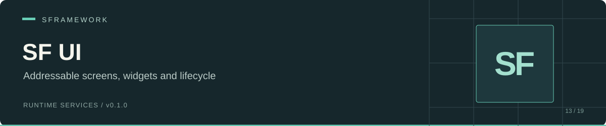

# SF UI

[Documentation website](https://docs.secretplace.studio/#sf-ui)

 

SF UI manages config-defined screens and widgets in Unity. It instantiates screen prefabs through Addressables, tracks screen state, and routes Unity EventSystem input through `ISFUIService`. Screen subclasses implement visibility and transition behavior.

Use it for menus that load on demand, reusable widget views, and controllers that need screen or widget events without holding prefab references.

[Install](#install) · [Configure](#configure) · [Screen implementation](#screen-implementation) · [API](#api) · [Limitations](#limitations)

## Install

In Unity Package Manager, select **Add package from git URL** and enter:

```text
https://github.com/huran438/sf-ui.git#main
```

The [manifest](package.json) declares no dependencies. Install these separately:

| Requirement | Reason |
| --- | --- |
| [SF Core](https://github.com/huran438/sf-core) | Service registration, injection, `SFView`, and `SFDebug`. |
| [SF Configs](https://github.com/huran438/sf-configs) | Config loading, tree IDs, models, and inspector attributes. |
| [SF Debug](https://github.com/huran438/sf-debug) | Assembly dependency of SF Core. |
| [UniTask](https://github.com/Cysharp/UniTask) | Async screen loading and service initialization. |
| Unity Addressables (`com.unity.addressables`) | `Unity.Addressables` and `Unity.ResourceManager` assemblies. |
| Newtonsoft.Json | SF Configs references `Newtonsoft.Json.dll`. |
| Unity UI / EventSystem | Canvas, CanvasGroup, GraphicRaycaster, and pointer/navigation events. |

Your assembly must reference `SFramework.UI.Runtime` and any SF assemblies your code uses. The source also imports `JetBrains.Annotations`. Ensure those annotations and the Unity UI assemblies resolve in your Unity setup.

`package.json` lists Unity `2019.4`, but the source uses newer C# syntax and SF Core uses `destroyCancellationToken`. Treat that value as package metadata, not a tested compatibility floor.

## Configure

Save this as a JSON TextAsset under a `Resources` folder, for example `Assets/Resources/SFramework/UI.json`. Keep `Type` first: SF Configs checks the first or last JSON property to identify a config.

```json
{
  "Type": "SFUIConfig",
  "Id": "ui",
  "Version": 1,
  "Groups": [{
    "Id": "menu",
    "Screens": [{
      "Id": "inventory",
      "Prefab": "UI/Inventory",
      "Preload": false,
      "CloseBehaviour": 0,
      "Widgets": [{ "Id": "close" }]
    }]
  }]
}
```

Mark the screen prefab Addressable with the address `UI/Inventory`. Add your `SFScreenView` subclass to its root and set the serialized **Screen** field to `ui/menu/inventory`. The required Canvas, CanvasGroup, and GraphicRaycaster components define its UI surface. Add an EventSystem to the scene for input.

The config tree produces `config/group/screen` IDs and `config/group/screen/widget` IDs. Assign `ui/menu/inventory/close` to the serialized **Widget** field on a child `SFWidgetView`. `SFScreenAttribute` selects depth 2; `SFWidgetAttribute` selects depth 3. Use unique IDs and initialize `Widgets` as an array, including `[]` when empty.

Register configs before UI in your context. SF Core constructs services during `Bind`, injects registered dependencies during `Setup`, then awaits `Init` in registration order.

```csharp
using System.Threading;
using Cysharp.Threading.Tasks;
using SFramework.Configs.Runtime;
using SFramework.Core.Runtime;
using SFramework.UI.Runtime;

public sealed class UIContext : SFContextRoot
{
    protected override void PreInit() { }

    protected override void Bind()
    {
        SFContainer.Register<ISFConfigsService, SFConfigsService>();
        SFContainer.Register<ISFUIService, SFUIService>();
    }

    protected override async UniTask Init(CancellationToken cancellationToken)
    {
        var ui = SFContainer.Resolve<ISFUIService>();
        await ui.ShowScreen("ui/menu/inventory", false,
            progress: null, cancellationToken: cancellationToken);
    }
}
```

Add this context to your startup scene. Call screen APIs after its initialization; other code can await `context.WaitForInitialization()`.

## Screen implementation

Save this class as `InventoryScreen.cs` and attach it to the Addressable prefab. This example completes each transition immediately. An animated screen should invoke each callback after its animation finishes.

```csharp
using SFramework.UI.Runtime;

public sealed class InventoryScreen : SFScreenView
{
    protected override void OnShowScreen(bool force, object[] parameters)
    {
        Canvas.enabled = true;
        CanvasGroup.alpha = 1f;
        CanvasGroup.interactable = true;
        CanvasGroup.blocksRaycasts = true;
        ScreenShownCallback();
    }

    protected override void OnCloseScreen(bool force, bool unload)
    {
        CanvasGroup.alpha = 0f;
        CanvasGroup.interactable = false;
        CanvasGroup.blocksRaycasts = false;
        Canvas.enabled = false;
        ScreenClosedCallback();
    }

    protected override void OnScreenShown() { }
    protected override void OnScreenClosed() { }
    protected override void OnScreenDestroy() { }
}
```

The service sets `Show` or `Close` before broadcasting the request. Your callbacks advance it to `Shown` or `Closed`; the closed callback also unloads when requested. `force` reaches your view, but the service still ignores show requests for screens in `Show`/`Shown` and close requests in `Close`/`Closed`.

`SFWidgetView` registers in `Start`, derives its screen ID from the config or parent screen, and routes pointer events to protected methods such as `PointerClick(PointerEventData eventData)`. Its `Index` defaults to zero; assign distinct indices when sharing a widget ID across multiple views. Subscribe to `OnWidgetBaseEvent` for selection, move, submit, and cancel events.

## API

The [interface](Runtime/ISFUIService.cs) extends `ISFService`, including `UniTask Init(CancellationToken cancellationToken)` and `void Dispose()`.

| Signature | Behavior |
| --- | --- |
| `UniTask LoadScreen(string screen, bool show, bool force, IProgress<float> progress = null, CancellationToken cancellationToken = default, params object[] parameters)` | Instantiates a configured prefab; optionally requests show. The interface requires both booleans. |
| `UniTask ShowScreen(string screen, bool force, params object[] parameters)` | Loads when needed, then sends the show request. |
| `UniTask ShowScreen(string screen, bool force, IProgress<float> progress = null, CancellationToken cancellationToken = default, params object[] parameters)` | Adds progress and cancellation to loading. |
| `void SetParameters(string screen, params object[] parameters)` | Calls the registered view's virtual `SetParameters(object[] parameters)`. |
| `void CloseScreen(string screen, bool force, bool unload)` | Sends a close request; the view completes it. |
| `void UnloadScreen(string screen)` | Releases the stored Addressables handle; throws if no handle exists. |
| `bool TryGetScreenView(string screen, out SFScreenView screenView)` / `bool TryGetScreenView<T>(string screen, out T screenView) where T : SFScreenView` | Looks up a registered view. |
| `bool TryGetScreenModel(string screen, out SFScreenModel screenModel)` | Looks up state and `IsLoaded`. |
| `bool TryGetWidgetView(string widget, int index, out SFWidgetView view)` / `bool TryGetWidgetView<T>(string widget, int index, out T view) where T : SFWidgetView` | Looks up a registered widget instance. Validate the index first. |
| `bool TryGetWidgetNode(string widget, out SFWidgetNode widgetNode)` / `bool TryGetWidgetModel(string widget, out SFWidgetModel widgetModel)` | Looks up config or the model's `Views` list. |
| `void RegisterScreen(string screen, SFScreenView root)` / `void UnregisterScreen(string screen)` | View lifecycle hooks; screen ID must exist in config. |
| `void RegisterWidget(string widget, SFWidgetView widgetView)` / `void UnregisterWidget(string widget, SFWidgetView widgetView)` | Widget lifecycle hooks. |
| `void ScreenShownCallback(string screen)` / `void ScreenClosedCallback(string screen, bool unload)` | Completes a transition. |
| `void WidgetEventCallback(string widget, SFBaseEventType eventType, BaseEventData eventData)` | Publishes navigation/base input. |
| `void WidgetEventCallback(string widget, int index, SFPointerEventType eventType, PointerEventData eventData)` | Publishes pointer input. |

`ScreenModels` and `WidgetModels` return arrays of the current models. Events use these signatures:

| Event | Payload |
| --- | --- |
| `OnShowScreen` | `Action<string, bool, object[]>` |
| `OnCloseScreen` | `Action<string, bool, bool>` |
| `OnUnloadScreen`, `OnScreenUnloaded`, `OnScreenShown`, `OnScreenClosed` | `Action<string>` |
| `OnWidgetBaseEvent` | `Action<string, SFBaseEventType, BaseEventData>` |
| `OnWidgetPointerEvent` | `Action<string, int, SFPointerEventType, PointerEventData>` |

## Limitations

- `SFUICloseBehaviour` defines `DisableCanvas`, `DisableObject`, and `Unload`, but `SFUIService` does not read the config's `CloseBehaviour`. Implement visibility in your screen and pass `unload` to `CloseScreen` when needed.
- `TryGetWidgetView` clamps to `widgets.Count`, then indexes the list. An index equal to or above the count can throw. `UnregisterWidget` removes the whole ID entry, even when other views share it; the model removes only the specified view.
- Loading the same screen while its handle already exists returns without awaiting the existing operation. Coordinate concurrent show/load calls. Loading failure can leave the model in `Show` after `ShowScreen` sets the state.
- `Dispose()` does not unload screens or destroy the `SFUI` parent. The service creates that parent without `DontDestroyOnLoad`; plan scene changes and cleanup in your application.
- `HasParameter` in [SFExtensions](Runtime/SFExtensions.cs) always returns `false`. `TryGetParameterValue` assumes the matching string contains `=` and indexes its split result.

For missing screens, check the complete config ID, the prefab address, and config initialization order. A visible screen stuck in `Show` needs `ScreenShownCallback`; a closed screen stuck in `Close` needs `ScreenClosedCallback`.

## Source and related modules

[Service](Runtime/SFUIService.cs) · [Screen base](Runtime/SFScreenView.cs) · [Widget base](Runtime/SFWidgetView.cs) · [Config](Runtime/SFUIConfig.cs) · [Assembly](Runtime/SFramework.UI.Runtime.asmdef)

[SF Core](https://github.com/huran438/sf-core) provides the lifecycle; [SF Configs](https://github.com/huran438/sf-configs) loads the JSON tree; [SF Scenes](https://github.com/huran438/sf-scenes) manages additive scene loading.

Documentation reflects source snapshot `20dbb4860c12058eca642ce1b2f8ae5e6842eda3`. API and dependency checks were static; no Unity compile, play-mode run, or Addressables build was performed.

## License

MIT. See [LICENSE.md](LICENSE.md) for the terms.
